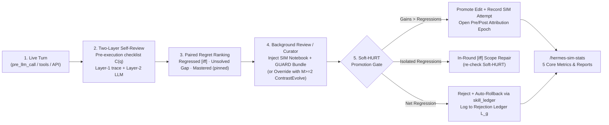

<div align="center">

# hermes-sim-guard

**Make your Hermes AI agent genuinely smarter over time — without forgetting what already works, bloating its skills, or breaking when you switch models.**

[-b31b1b?style=for-the-badge&logo=arxiv&logoColor=white)](https://arxiv.org/abs/2611.18856)
[-b31b1b?style=for-the-badge&logo=arxiv&logoColor=white)](https://arxiv.org/abs/2611.23476)
[](https://github.com/NousResearch/hermes-agent)
[](https://github.com/NousResearch/hermes-agent/pull/157950)
[](https://www.python.org/)
[](https://github.com/NousResearch/hermes-agent)
[](./LICENSE)

</div>

---

## What Does This Plugin Do? (In Plain English)

Modern AI assistants like **Hermes Agent** learn on the job by writing and editing **skills** (reusable markdown playbooks) in the background after you finish a task. In theory, the more you use your agent, the better it gets.

**In practice, unguided self-editing often backfires:**
- **Whack-a-mole regressions:** The agent fixes one mistake by adding a broad rule (*"Always double-check X before replying"*), which accidentally breaks three other tasks that already worked fine.
- **Amnesia across model switches:** You spend weeks tuning skills on Claude, switch to Gemini (or move to a new project), and the agent has no idea *why* an old rule existed — so it either blindly keeps a harmful workaround or deletes a critical safeguard.
- **Skill bloat & repeating dead ends:** Without remembering rejected ideas, the agent keeps proposing the same bad edit over and over, swelling skill files and wasting tokens on every turn.
- **No proof it's actually helping:** You can't easily tell whether last week's automatic skill edits improved accuracy, cut token costs, or quietly made things worse.

**`hermes-sim-guard` fixes all four problems as a drop-in Hermes plugin** — without touching Hermes core agent logic. Think of it as giving your agent's background self-improvement loop **two missing superpowers plus a live dashboard**:

1. **A Lab Notebook (SIM):** Records *why* every skill edit was made, what problem it aimed to solve, what it predicted would improve, what actually happened afterward, and which model/domain was used — so lessons carry over cleanly across tasks and model upgrades.
2. **A Quality Gate & Safety Brake (GUARD):** Grades finished turns against a pre-execution checklist, separates **newly broken** rules from **unsolved** gaps, locks down rules that already work, scopes narrow fixes to `[iff <precondition>]` triggers, and **automatically rolls back** any skill edit whose regressions outweigh its gains.
3. **Rolling Pre/Post Attribution (`/hermes-sim-stats`):** Measures 5 concrete quantitative metrics over a rolling window of turns *before* vs *after* every promoted edit, so you can see with real numbers whether self-improvement is paying off.

---

## How It Works



> **Zero prompt-cache penalty:** In the default `augment+gate` mode, `hermes-sim-guard` runs its hook on Hermes's background review worker thread and appends the SIM + GUARD context to the review fork's user message — leaving the foreground turn latency at **0 ms** and keeping **100% prompt-cache prefix parity** with your live conversation.

---

## The Two Research Papers Behind This Plugin

This plugin combines two complementary November 2026 research papers on **Recursive Self-Improvement (RSI)** for AI agent harnesses:

### 1. SIM — *Self-Improvement Memory Enables Continual Recursive Self-Improvement*
- **Paper:** [arXiv:2611.18856](https://arxiv.org/abs/2611.18856) (Nov 13, 2026)
- **Authors:** Xin Yu, Fei Xia, Jiaqi Pan, Youbao Tang, Chengzhi Liu, Adams Yu, Sicong Jiang, Yanfei Chen, Lingzhou Xue, Ting Yu *(Google Cloud AI, Google DeepMind, Penn State)*
- **The Key Insight:** When an agent's underlying LLM or task domain changes (e.g., migrating an evolved harness from Claude Opus to Gemini Flash, or moving to a new benchmark), transferring *only the final evolved code/skills* often causes performance regressions — because the artifact doesn't explain **why** earlier edits were written or **which** hypotheses failed.
- **How It Works:** SIM gives the *harness optimizer* (not just the task solver) a structured memory ledger that groups every edit under its recurring root-cause hypothesis $m_i = (c_i, [(a_{ij}, o_{ij}, p_{ij})]_j)$ — recording the edit rationale, **predicted vs. observed outcomes**, and full provenance (model, provider, domain, round). Entries with matching root causes merge deterministically without dropping history.
- **In This Plugin (`sim_memory.py`):** Persists `sim_memory.json` per Hermes profile, tracks model/domain switches via `carried_from`, injects the full SIM history + Appendix D.2 decision rules into background reviews and curator passes, and automatically backfills `predicted → fixed / missed` outcomes from subsequent live turns.

### 2. GUARD — *Stabilizing Recursive Self-Improvement with Regret Guidance*
- **Paper:** [arXiv:2611.23476](https://arxiv.org/abs/2611.23476) (Nov 17, 2026)
- **Authors:** Minghe Zhang, Xuetao Kang, Yifei Ming, Yanfei Chen, Han Yu, Yufan Zhuang, Chen-Yu Lee *(Google Cloud)*
- **The Key Insight:** Self-editing without an external grader often causes local regressions, catastrophic skill forgetting, and memory bloat because a single scalar score conflates *what an edit newly broke* with *what was never solved in the first place*.
- **How It Works:** GUARD turns self-improvement into a four-stage reference-free closed loop:
  1. **Pre-Execution Checklists & Two-Layer Self-Review:** Decomposes a task into atomic binary checks $\mathcal{C}(q)$ *before* looking at the answer, then grades execution checks deterministically (Layer 1) and semantic rules individually (Layer 2) into $S(\tau)$ and strict score $S^{\text{strict}}(\tau)$.
  2. **Paired Directional Regret Ranking (Analyze):** Computes $\Delta_{\text{hurt}}$ (newly broken rules) and $\Delta_{\text{gap}}$ (unsolved shortfalls) with $\mathrm{Priority}_t(c) = \Delta_{\text{hurt}} + \Delta_{\text{gap}} \in [0, 2]$, splitting rules into **Regressed** (wrap in `[iff <trigger>]`), **Unsolved Gap** (add procedure), and **Mastered** (pin so future edits cannot break them).
  3. **Group-Relative Candidate Pooling & `ContrastEvolve` (Propose):** Samples $M \ge 2$ competing edits from a strategy prompt pool $\mathcal{P}_{t,g}$, ranks them by standardized group advantage $\hat{A}_m$ (penalizing hurts more heavily than rewarding helps, $\beta > \gamma$), and contrasts best vs. worst candidates to evolve better editing prompts over time.
  4. **Soft-HURT Promotion Gate & Rejection Ledger (Gate):** Only promotes an edit when net gains strictly outweigh induced regressions ($\bar{S}(\tilde{W}) - \bar{S}(W_{t-1}) > \max(\mathrm{Hurt}, \mu_{\min})$). Isolated regressions trigger at most one in-round `[iff]` scope-narrowing repair; anything else is rejected, rolled back, and logged to a deduplicated rejection ledger $\mathcal{L}_g$ so the agent never repeats the same bad edit.
- **In This Plugin (`guard_checklist.py`, `guard_regret.py`, `guard_propose_gate.py`):** Implements all four stages, automatically rolling back rejected live edits through Hermes's native `skill_ledger` snapshot store.

---

## Rolling Pre/Post Attribution: 5 Core Quantitative Metrics

Whenever a skill edit clears the Soft-HURT gate, `hermes-sim-guard` opens an attribution epoch and compares a rolling window of **Pre** turns (default `W = 20` turns before the edit) against **Post** turns (`W = 20` turns after):

| # | Metric | Plain-English Meaning | What It Tracks |
|---|---|---|---|
| **1** | **Checklist Obedience & Strict Pass Rate** | *Are tasks actually succeeding more reliably?* | Rolling Pre → Post mean $S(\tau)$, strict all-pass score $S^{\text{strict}}(\tau)$, $\Delta\bar{S}$, $\Delta\bar{S}^{\text{strict}}$ |
| **2** | **Directional Regret & Soft-HURT Gate Health** | *Is self-improvement avoiding regressions?* | Mean $\Delta_{\text{hurt}}$, hurt-to-help ratio, Soft-HURT accept / repair / reject / auto-rollback rates |
| **3** | **SIM Prediction Calibration & Transfer Retention** | *Does our lab notebook predict real fixes and survive model switches?* | `predicted → fixed` precision, diagnosis reuse rate, cross-model & cross-domain retention delta |
| **4** | **Execution Efficiency Delta** | *Are evolved skills saving tokens and tool calls instead of adding bloat?* | Pre → Post tokens/turn ($\Delta\%$), prompt cache-read ratio, tool iterations per completed turn |
| **5** | **Skill Hygiene & Reuse** | *Are patched skills actually reused and kept concise?* | `reuse_after_patch` rate, skill character-budget ($B_W$) compliance, churn/rollback ratio |

---

## Two Execution Modes

Choose the balance of cost and rigor that fits your workflow via `plugins.entries.hermes-sim-guard.settings.mode`:

| Mode | How It Runs | Best For |
|---|---|---|
| **`augment+gate`** *(default)* | Keeps Hermes's fast warm-cache background review fork, injects the SIM notebook + GUARD regret/pinned-rules bundle via `pre_background_review`, and runs Soft-HURT gating + automatic `skill_ledger` rollback in `post_background_review`. | Everyday interactive use — lowest latency and token cost with full non-regression protection. |
| **`override`** | Skips Hermes's built-in single-pass skill fork via `pre_background_review → {"action": "skip"}` and runs GUARD's full $M \ge 2$ candidate pool + four-criterion critic + `ContrastEvolve` + Soft-HURT gate + in-round `[iff]` repair. | Heavy skill iteration, domain tuning, or evaluating competing skill rewrites systematically. |

Both modes also hook `pre_curator_run` and `post_curator_run` so background skill curation respects pinned Mastered rules, `[iff]` guards, and the rejection ledger.

---

## Installation & Quick Start

### Prerequisites
- **Hermes Agent** with the generic review/curator lifecycle hooks (`pre_background_review`, `post_background_review`, `pre_curator_run`) from [NousResearch/hermes-agent#157950](https://github.com/NousResearch/hermes-agent/pull/157950).

### 1. Install the Plugin
Clone into your Hermes user plugins directory:

```bash
git clone https://github.com/tsella/hermes-sim-guard.git ~/.hermes/plugins/hermes-sim-guard
```

### 2. Enable in `~/.hermes/config.yaml`
```bash
hermes plugins enable hermes-sim-guard
```

Or configure directly in `~/.hermes/config.yaml`:

```yaml
plugins:
  enabled:
    - hermes-sim-guard
  entries:
    hermes-sim-guard:
      settings:
        mode: augment+gate          # "augment+gate" (default) or "override"
        attribution_window: 20      # rolling Pre/Post window W (turns)
        playbook_max_chars: 2600    # GUARD skill body budget B_W
        enable_llm_review: true     # Layer-2 self-review & critic via sim_reviewer
        auto_rollback: true         # auto-rollback Soft-HURT rejections via skill_ledger

# Optional: route self-review & evolution to a fast/cheap auxiliary model
# (defaults to inheriting auxiliary.background_review)
auxiliary:
  sim_reviewer:
    provider: auto
    model: ""
  sim_evolver:
    provider: auto
    model: ""
```

### 3. Inspect Telemetry & Generate Reports

**Inside any Hermes session (`/hermes-sim-stats`):**
```text
/hermes-sim-stats
/hermes-sim-stats attribution --window 20 --skill deploy-helper
/hermes-sim-stats sim
/hermes-sim-stats guard
/hermes-sim-stats report --export ./sim-guard-report.md
```

**From your shell (`hermes sim-stats` or standalone drop-in CLI):**
```bash
hermes sim-stats summary --window 20
hermes sim-stats report --format md --export ./sim-guard-report.md
hermes sim-stats summary --format json

# Standalone drop-in CLI (works offline against any profile's plugin-data dir)
python3 ~/.hermes/plugins/hermes-sim-guard/reporter.py report --data-dir ~/.hermes/plugin-data/<namespace>
```

**Example `/hermes-sim-stats` Output:**
```text
Hermes SIM + GUARD Telemetry (rolling window W=20, events=84)
=============================================================

5 Core Quantitative Metrics (Rolling Pre -> Post Attribution):
  1. Checklist Obedience : S=91.50 (Pre 68.00 -> Post 95.00, delta +27.00) | Strict=85.00 (delta +45.00) [n=40]
  2. Directional Regret  : mean_delta_hurt=0.04 | hurt/help=0.14 | Soft-HURT accept=80.0% (4/5, repaired=1, rollbacks=1)
  3. SIM Calibration     : precision=87.5% | reuse=50.0% | problems=3 attempts=6 | x-model delta=+6.20
  4. Execution Efficiency: tokens/turn Pre 4120.00 -> Post 2940.00 (-28.64%) | cache=71.2% | tool iters delta=-1.80
  5. Skill Hygiene/Reuse : reuse-after-patch=90.0% (18/20) | B_W compliance=100.0% | churn/rollback=0.20
```

---

## Configuration Reference

| Key | Default | Description |
|---|---|---|
| `mode` | `augment+gate` | `augment+gate` (warm-cache augment + post-hoc gate) or `override` (full $M \ge 2$ ContrastEvolve loop) |
| `pool_size` | `2` | Candidate pool size $M \ge 2$ in `override` mode |
| `beta_hurt` | `3.5` | GUARD fitness penalty $\beta$ on hurt episodes ($\beta > \gamma \ge 0$) |
| `gamma_help` | `1.5` | GUARD fitness bonus $\gamma$ on helped episodes |
| `delta_noise` | `2.0` | Single-task score noise floor $\delta_{\text{noise}}$ |
| `delta_contrast` | `10.0` | Minimum continuous score gap $\delta_{\text{con}}$ for $(\tau^+, \tau^-)$ contrasts |
| `h_max` | `1` | Soft-HURT maximum tolerated hurt tasks $h_{\max}$ |
| `h_rep` | `2` | Soft-HURT maximum hurt tasks eligible for one in-round `[iff]` repair |
| `mu_min` | `2.5` | Soft-HURT minimum net-gain margin $\mu_{\min}$ when any regression occurs |
| `playbook_max_chars` | `2600` | Skill body character budget $B_W$ |
| `rejection_ledger_window` | `12` | Active rejection ledger entries $L_{\max}$ rendered into prompts |
| `attribution_window` | `20` | Default rolling Pre/Post attribution window $W$ |
| `enable_llm_review` | `true` | Enable LLM checklist & Layer-2 review (`false` uses deterministic Layer-1 only) |
| `auto_rollback` | `true` | Automatically roll back Soft-HURT rejected edits via `skill_ledger` |
| `checklist_min_tool_calls` | `1` | Minimum tool calls (or loaded skill) to trigger LLM checklist grading |

---

## Repository Structure

| File | Role |
|---|---|
| `plugin.yaml` | Manifest v2 metadata, hooks declaration, and `config_schema` |
| `__init__.py` | `register(ctx)` entrypoint: auxiliary slots, 10 hooks, `/hermes-sim-stats`, `hermes sim-stats` |
| `config.py` | Immutable `SimGuardConfig` parsed from `ctx.get_config` |
| `sim_memory.py` | SIM root-cause ledger, deterministic merging, cross-model provenance, calibration stats |
| `guard_checklist.py` | Pre-execution checklist $\mathcal{C}(q)$, Layer-1/2 self-review, $S(\tau)$ & $S^{\text{strict}}(\tau)$ |
| `guard_regret.py` | Paired regret ranking ($\Delta_{\text{hurt}}$, $\Delta_{\text{gap}}$, $\mathrm{Priority}_t$) & trajectory contrasts |
| `guard_propose_gate.py` | Strategy prompt pool, critic scoring, `ContrastEvolve`, Soft-HURT gate, rejection ledger, rollback |
| `telemetry.py` | Thread-safe JSONL event store + 5-metric rolling Pre/Post attribution engine |
| `reporter.py` | Terminal, Markdown, and JSON report generator (slash command, Hermes CLI, standalone CLI) |
| `runtime.py` | Profile-safe hook coordinator for both `augment+gate` and `override` modes |
| `tests/test_sim_guard_plugin.py` | Unit + end-to-end tests against isolated `HERMES_HOME` and real `PluginManager` discovery |

---

## Running Tests

From your `hermes-agent` checkout:

```bash
scripts/run_tests.sh ~/.hermes/plugins/hermes-sim-guard/tests/test_sim_guard_plugin.py -q
hermes plugins validate ~/.hermes/plugins/hermes-sim-guard
```

---

## Citations

```bibtex
@article{yu2026sim,
  title   = {Self-Improvement Memory Enables Continual Recursive Self-Improvement},
  author  = {Yu, Xin and Xia, Fei and Pan, Jiaqi and Tang, Youbao and Liu, Chengzhi and Yu, Adams and Jiang, Sicong and Chen, Yanfei and Xue, Lingzhou and Yu, Ting},
  journal = {arXiv preprint arXiv:2611.18856},
  year    = {2026}
}

@article{zhang2026guard,
  title   = {GUARD: Stabilizing Recursive Self-Improvement with Regret Guidance},
  author  = {Zhang, Minghe and Kang, Xuetao and Ming, Yifei and Chen, Yanfei and Yu, Han and Zhuang, Yufan and Lee, Chen-Yu},
  journal = {arXiv preprint arXiv:2611.23476},
  year    = {2026}
}
```

## License

MIT — see [LICENSE](./LICENSE).
